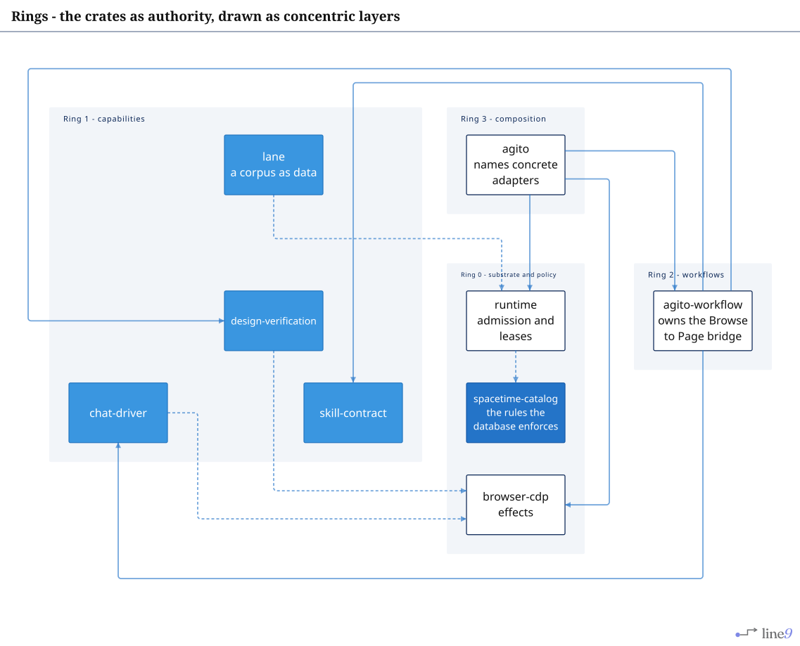
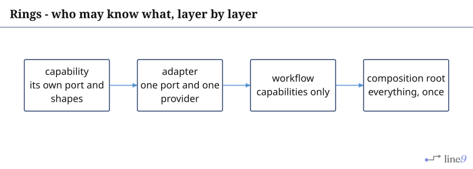
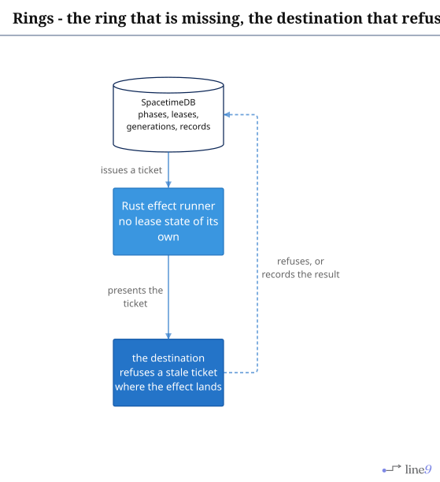
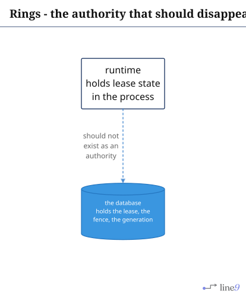

# Rings

The crates as concentric authority: what may know what, drawn as rings rather than as a dependency
list.

## Page 1 - the rings

[`Ring.mmd`](Ring.mmd) · [`Ring.svg`](Ring.svg)

The dotted edges carry the rule: a capability declares the port it needs and imports nobody.
`browser-cdp` is the only crate in Ring 0 that touches the outside world, and `spacetime-catalog` is
the only one that holds the rules the database enforces.

---

## Page 2 - who may know what

[`Who-May-Know.mmd`](Who-May-Know.mmd) · [`Who-May-Know.svg`](Who-May-Know.svg)

A crate that knows more than its ring is a defect even when it compiles, and the graph makes the
boundary checkable: `cargo tree -p agito-chat-driver | grep -c browser` answers `0`.

---

## Page 3 - the ticket with no destination

[`Missing-Ring.mmd`](Missing-Ring.mmd) · [`Missing-Ring.svg`](Missing-Ring.svg)

`X` is drawn as an installable step because nothing records a landing. The port exists:
`Destination::Present` takes a ticket and a name and answers with what was recorded
(`Crate/RunTime/Source/Struct/Port.rs:470`), and its only implementation is the scripted stand-in
the runtime ships for a consumer's own tests (`Crate/RunTime/Source/Struct/StandIn.rs:439`). Without
a destination that writes to a database, the runtime crate is a second authority over the same
vocabulary - see `Documentation/Review.md`.

---

## Page 4 - the lease state the runtime holds

[`Disappearing-Ring.mmd`](Disappearing-Ring.mmd) · [`Disappearing-Ring.svg`](Disappearing-Ring.svg)

The lease, the fence and the generation are internalities. The runtime keeps them in the process,
and the database is the other place they can live; a process that owns them is a parallel system,
however correct its fencing.
