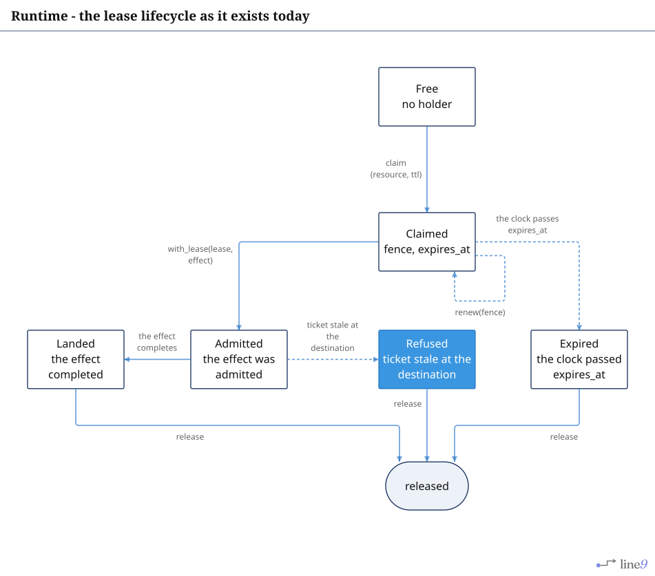
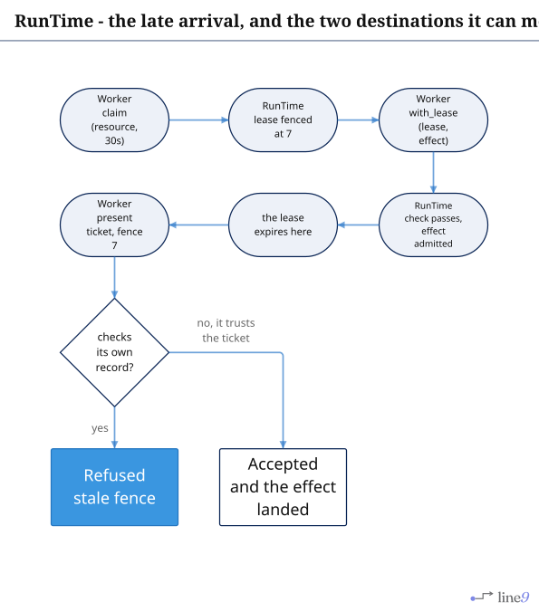
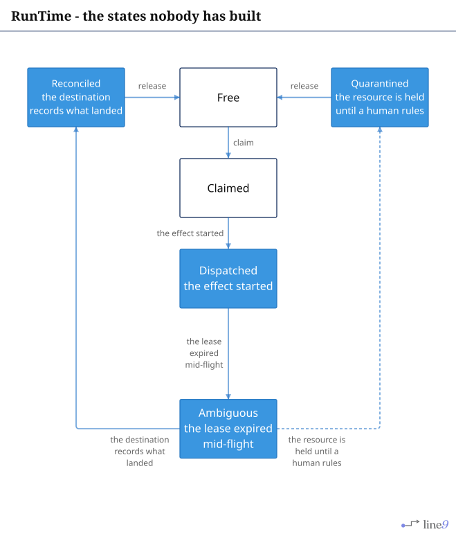
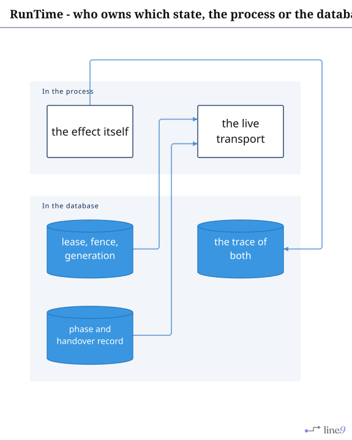

# RunTime

The lease and effect lifecycle: the states the crate moves, and the ones it does not model.

## Page 1 - the lease

[`Lifecycle.mmd`](Lifecycle.mmd) · [`Lifecycle.svg`](Lifecycle.svg)

`Refused` is a state the port carries: a claim refused while another holder owns the lease, reported
as a result rather than a panic. Whether a _destination_ has a matching state is one of the
questions `Documentation/Open-Questions.md` records.

---

## Page 2 - the late arrival, which is the counterexample

[`Late-Arrival.mmd`](Late-Arrival.mmd) · [`Late-Arrival.svg`](Late-Arrival.svg)

The page is a flowchart rather than a sequence diagram: `line9 render --out` serves flowcharts only,
and a `sequenceDiagram` exits `9`. The order of the five events is the sequence.

The second branch is what fencing the caller means. A write that landed is not retracted because the
record of it was refused.

---

## Page 3 - states the crate does not model

[`Missing.mmd`](Missing.mmd) · [`Missing.svg`](Missing.svg)

`Dispatched`, `Ambiguous`, `Reconciled` and `Quarantined` are drawn as installable steps because no
state carries them. They cover work already in flight when its authority ends, which `Refused` alone
cannot: refusing a result says nothing about the effect that already happened.

---

## Page 4 - who owns which state

[`Ownership.mmd`](Ownership.mmd) · [`Ownership.svg`](Ownership.svg)

The left column is effects. The right column is internalities. `Dispatched` and `Ambiguous` belong
on the right, which is why the crate cannot be the authority for them.
