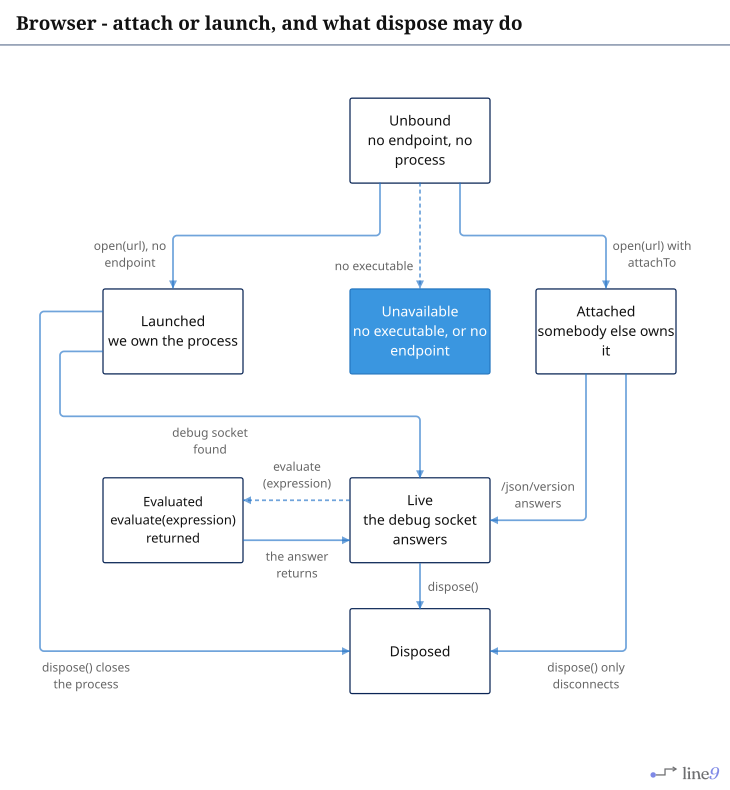
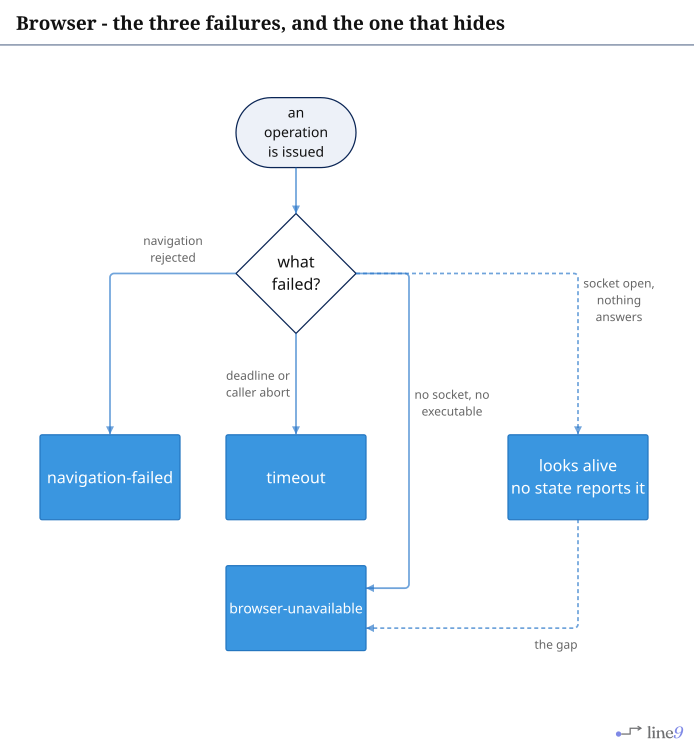
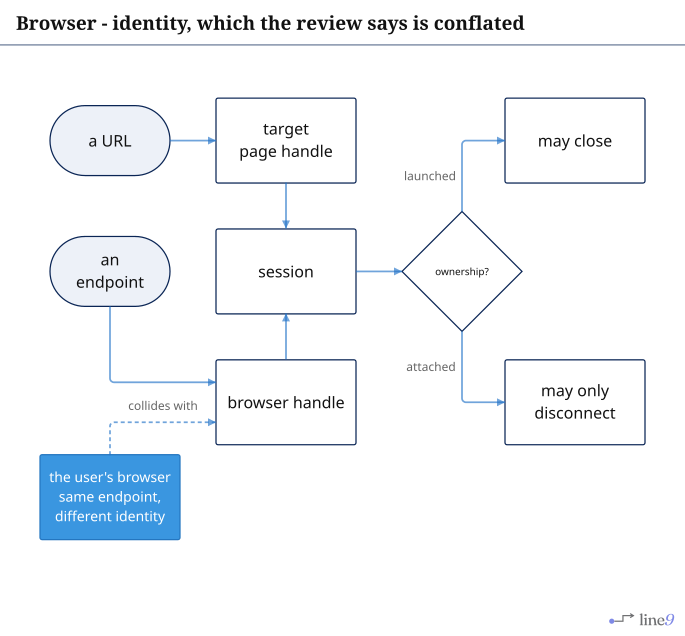
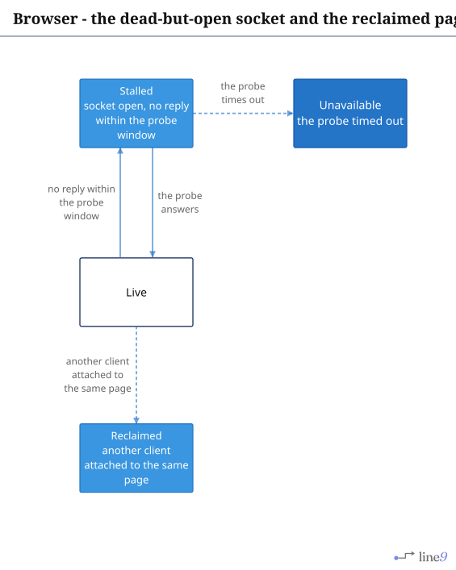

# Browser

The CDP adapter's lifecycle: attach versus launch, and the failures a session that is not alive can
report.

## Page 1 - attach or launch

[`Lifecycle.mmd`](Lifecycle.mmd) · [`Lifecycle.svg`](Lifecycle.svg)

The distinction that holds on every path: `dispose` on a launched session may close the browser; on
an attached session it must not, because somebody else owns it.

---

## Page 2 - the three failures, and the one that hides

[`Failures.mmd`](Failures.mmd) · [`Failures.svg`](Failures.svg)

`looks alive` is the state the adapter cannot name: an open socket is not a live browser. The
liveness probe is what separates them, which is why the manifest gives this crate the
`HoldTransport` state class and an admission check.

---

## Page 3 - identity

[`Identity.mmd`](Identity.mmd) · [`Identity.svg`](Identity.svg)

Three things are called "the browser" here: an endpoint, a page, and a user. A `Target` carries its
ownership, and an endpoint is never treated as an identity.

---

## Page 4 - states the adapter does not model

[`Missing.mmd`](Missing.mmd) · [`Missing.svg`](Missing.svg)

`Stalled` and `Reclaimed` are drawn as installable steps because no state carries them. Both are
real: the first is the dead-but-open socket, the second is two debugger clients on one page - which
is what happens when a second tool attaches to a tab an extension already holds.
