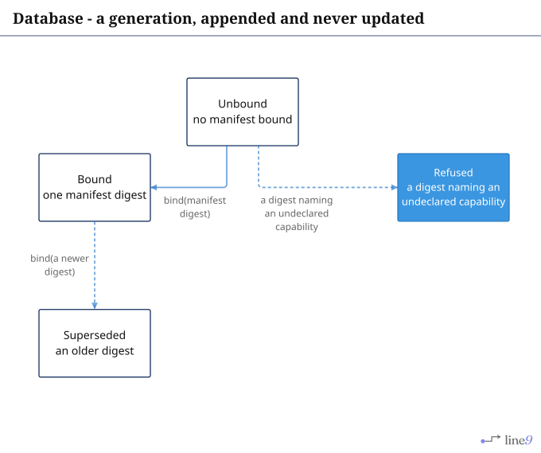
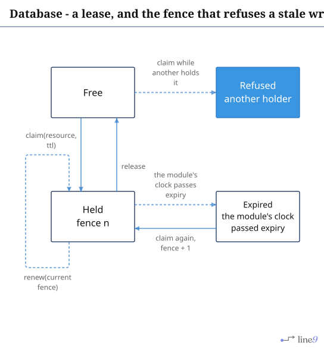
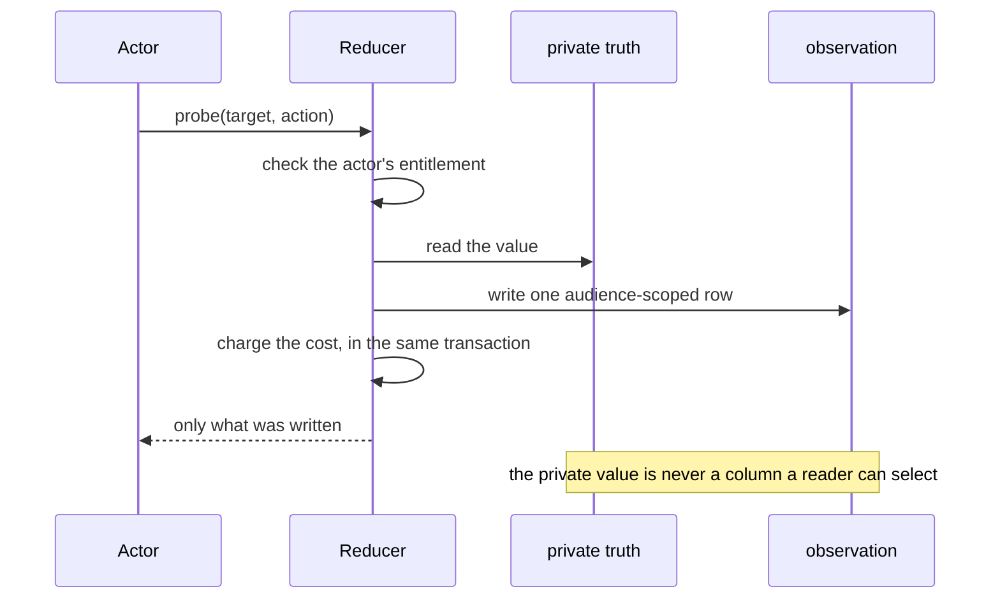
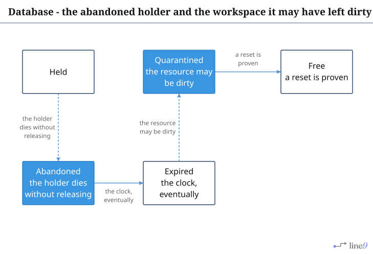

# Database

The rules the database enforces, as states. Everything here is an internality: a reducer moves it,
and a subscriber sees the move.

## Page 1 - a generation

[`Generation.mmd`](Generation.mmd) · [`Generation.svg`](Generation.svg)

A generation is appended, never updated. The rule that makes it useful: a write under a generation
that is not the latest bound one is refused, and the refusal names the generation it saw.

---

## Page 2 - a lease, and the fence

[`Lease.mmd`](Lease.mmd) · [`Lease.svg`](Lease.svg)

The fence increments on every grant. A write carrying an old fence is refused - not queued, not
applied late. `Refused` is a result, never a panic.

---

## Page 3 - a probe, and why a receipt is not a disclosure

This is the one diagram in the set that has no `.mmd`: it cannot be exported, because
`line9 render --out` serves flowcharts only and a `sequenceDiagram` exits `9` without writing
anything. The lanes are doing the work here - four participants, a private read and an
audience-scoped write inside one transaction - and a flowchart would flatten who may see what into a
chain of steps.

The review's point stands: a receipt is evidence that a probe happened, not a mechanism that
prevented a leak. The leak is prevented by the private value never being selectable, and by the
observation being tied to a property version so an old grant cannot silently authorise a future
change.

---

## Page 4 - missing states

[`Missing.mmd`](Missing.mmd) · [`Missing.svg`](Missing.svg)

`Abandoned` and `Quarantined` do not exist - they are drawn as installable steps. Expiry covers the
clock; nothing covers the workspace a dead holder may have left dirty, which is the
`HoldWorkspace` class the manifest names and the schema does not yet model.
