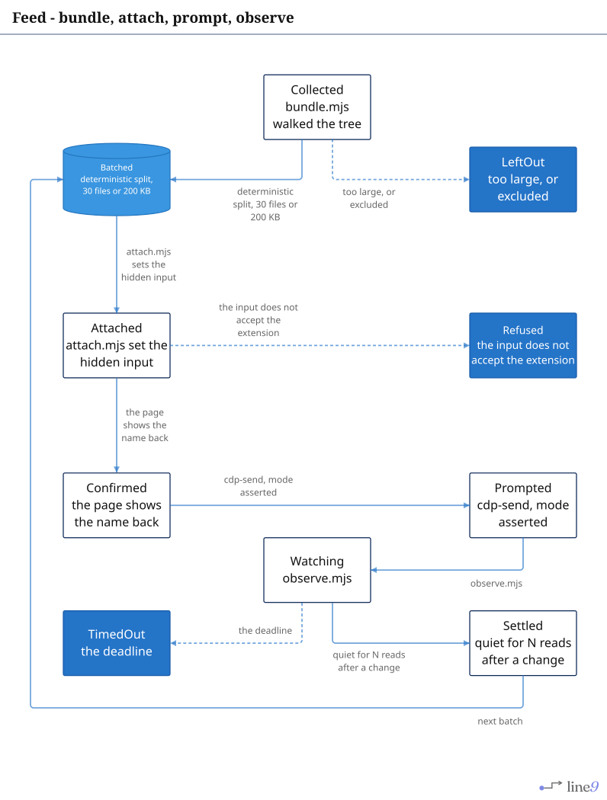
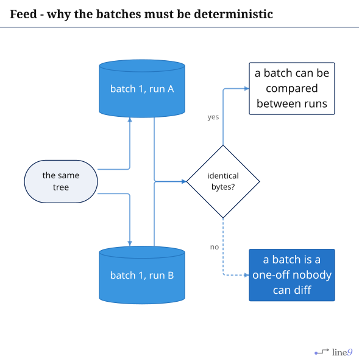
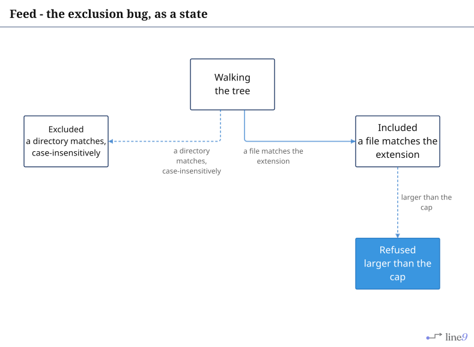
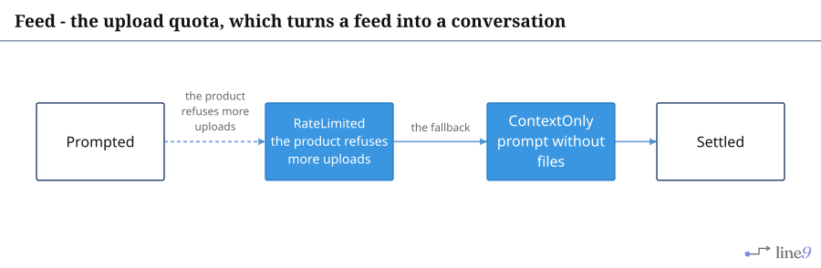

# Feed

Carrying a corpus into a chat product: bundle, attach, observe. The pages draw the sequence; the
bundler and the attach step are not in this tree.

## Page 1 - the feed

[`Lifecycle.mmd`](Lifecycle.mmd) · [`Lifecycle.svg`](Lifecycle.svg)

The gate that matters: `Confirmed` is reached only when the page itself shows the file name. A
successful `setFileInputFiles` call is not evidence that the product accepted the file.

---

## Page 2 - why the batches are deterministic

[`Determinism.mmd`](Determinism.mmd) · [`Determinism.svg`](Determinism.svg)

A feed whose batches differ between runs cannot be reviewed - only re-read. The bundler that
produced them is not in the tree, and `Documentation/Open-Questions.md` records the determinism gate
among the questions still open.

---

## Page 3 - the exclusion bug, as a state

[`Exclusion.mmd`](Exclusion.mmd) · [`Exclusion.svg`](Exclusion.svg)

The first version compared case-sensitively, so `Target/` walked past an exclude of `target` and
three files of build scratch were attached as a batch. On a case-sensitive volume those are
different directories, and the fix belongs in the walker, not in the prompt.

---

## Page 4 - the rate limit

[`Missing.mmd`](Missing.mmd) · [`Missing.svg`](Missing.svg)

`RateLimited` is drawn as an installable step because no state carries it. A weekly upload quota
turns a feed into a text-only conversation, and nothing in the tree detects it other than by reading
the product's own error.
