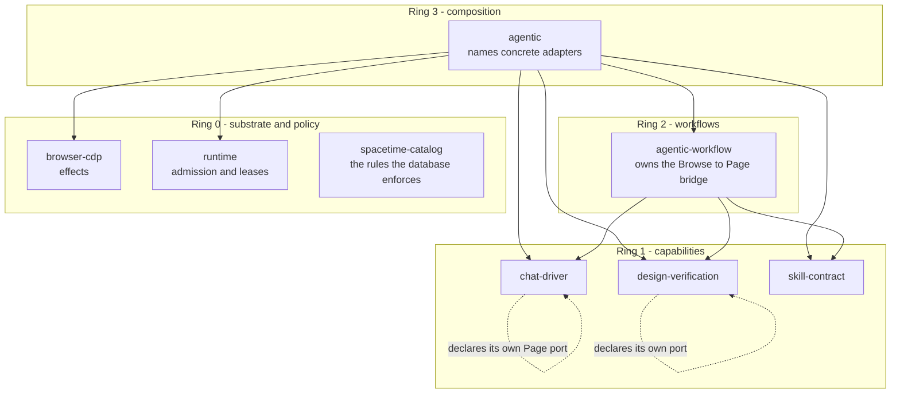
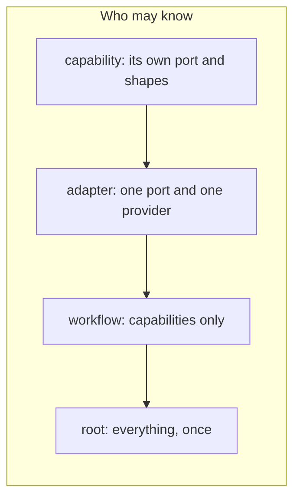
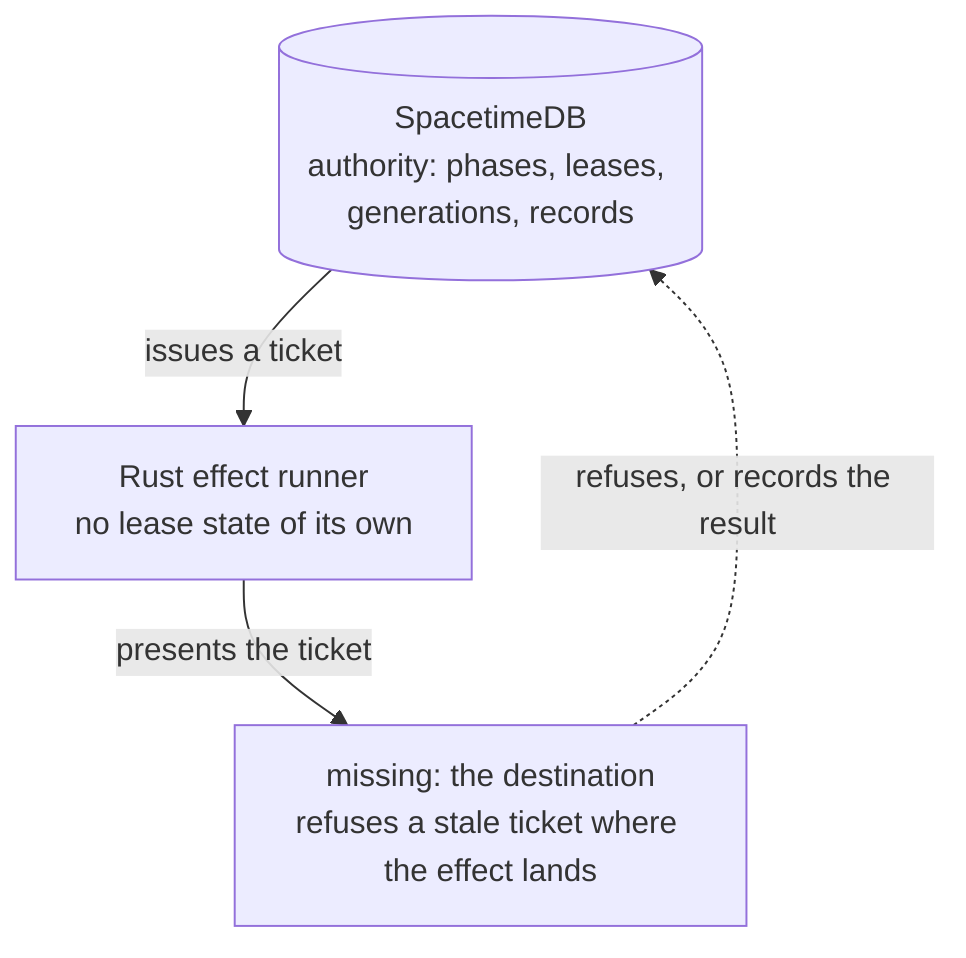
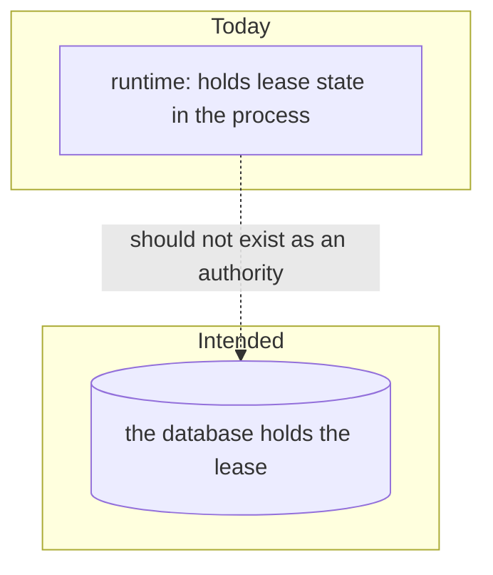

# Rings

The crates as concentric authority: what may know what, drawn as rings rather than as a dependency
list. Each page below is separated by a rule; later pages are the intended shape, not the current
one.

## Page 1 - the rings as they are intended

The dotted self-edges are the point: a capability declares what it needs and imports nobody.
`browser-cdp` is the only crate in Ring 0 that touches the outside world.

---

## Page 2 - what the rings are for

A crate that knows more than its ring is a defect even when it compiles, which is why
`Scripts/Boundaries.mjs` exists and why `cargo tree -p agentic-chat-driver | grep -c browser` must
answer `0`.

---

## Page 3 - the ring that is missing

`X` does not exist yet. Until it does, the runtime crate is a second authority wearing the same
vocabulary - see `docs/Review.md` and the card that names this gap.

---

## Page 4 - the ring that should disappear

The lease, the fence and the generation are internalities. A process that owns them is a parallel
system, however correct its fencing.
