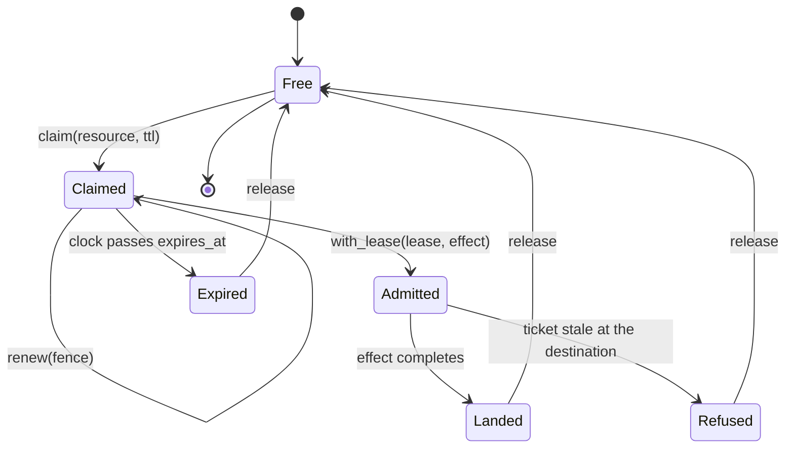
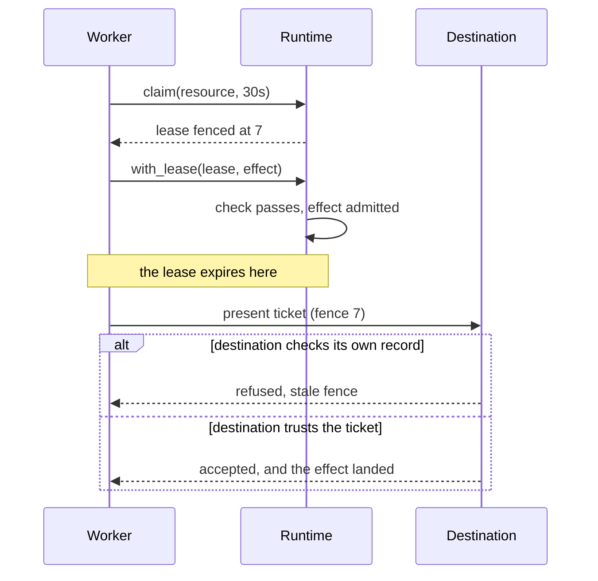
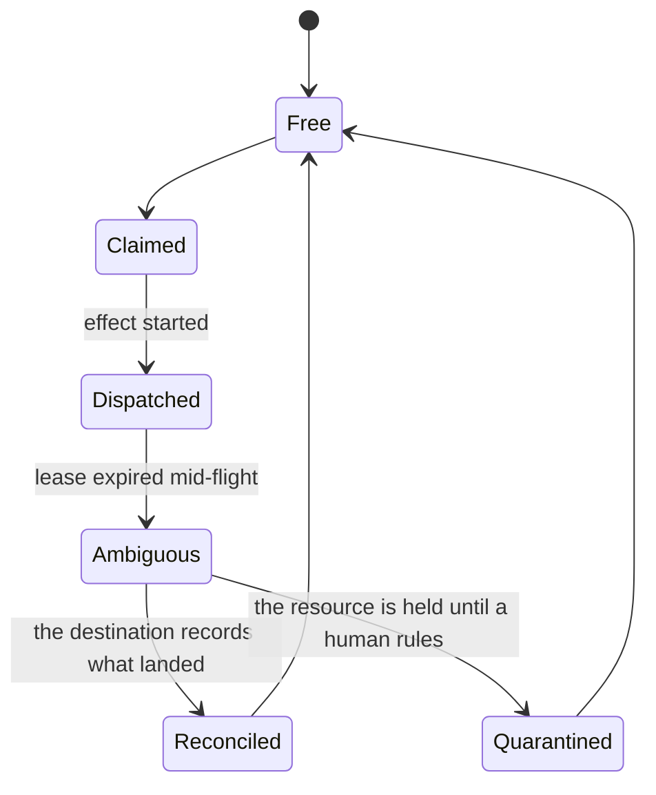
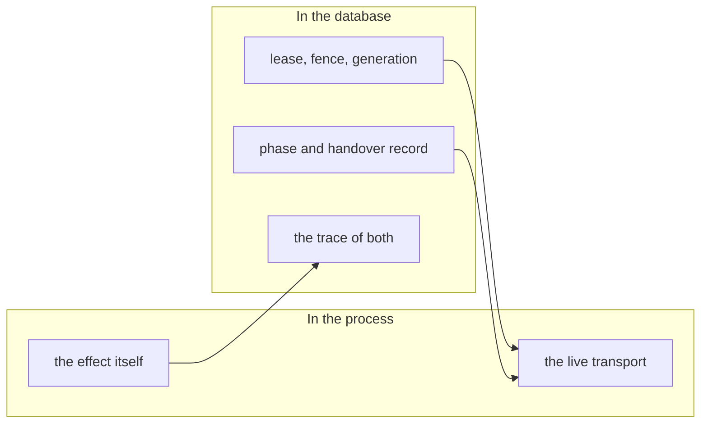

# Runtime

The lease and effect lifecycle, as it is and as it should be. Pages are separated by a rule; the
last page is the one with states nobody has built.

## Page 1 - the lease as it exists today

`Refused` is the state the fence card added. It exists in the port and is exercised by tests;
whether it exists at a _destination_ is the open question.

---

## Page 2 - the late arrival, which is the counterexample

The second branch is what "fencing the caller" means. A write that landed is not retracted because
the record of it was refused.

---

## Page 3 - missing states

None of `Dispatched`, `Ambiguous`, `Reconciled` or `Quarantined` exists. They are the handover rule
the review demanded: what happens to work already in flight when its authority ends. `Refused` alone
cannot cover it, because refusing a result says nothing about the effect that already happened.

---

## Page 4 - who owns which state

The left column is effects. The right column is internalities. `Dispatched` and `Ambiguous` belong
on the right, which is why the crate cannot be the authority for them.
