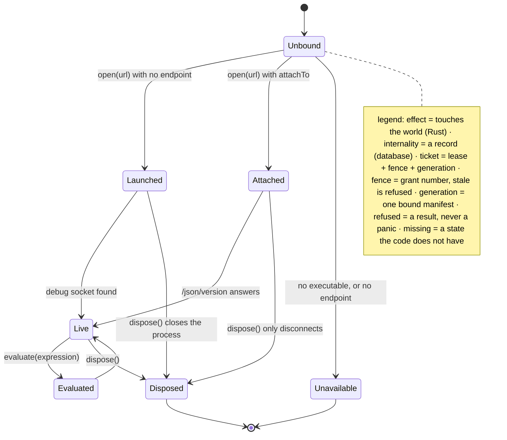
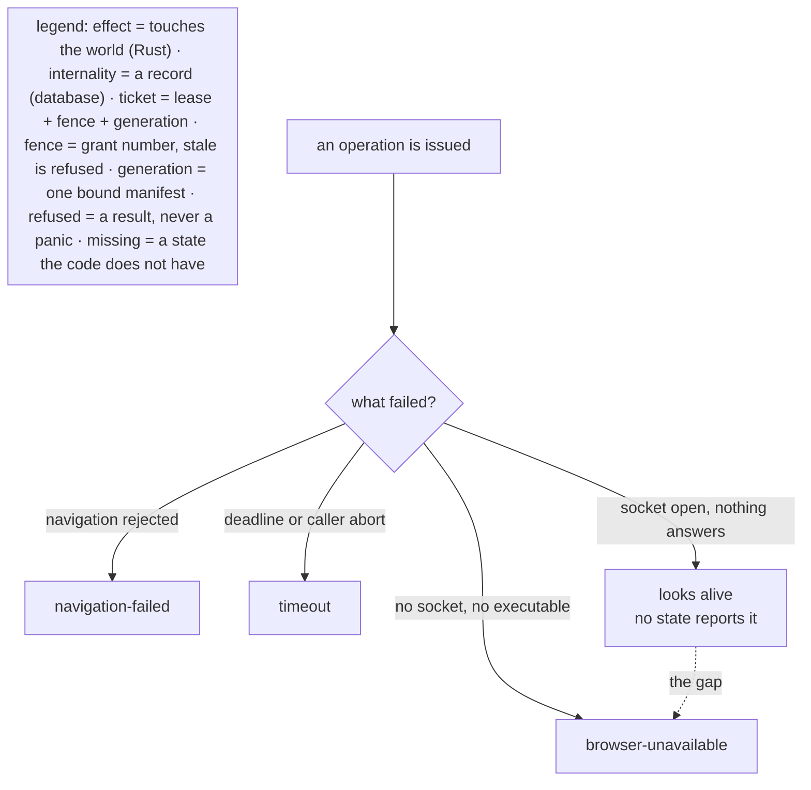
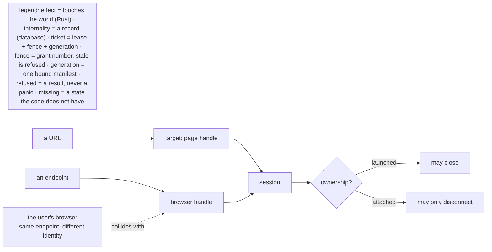
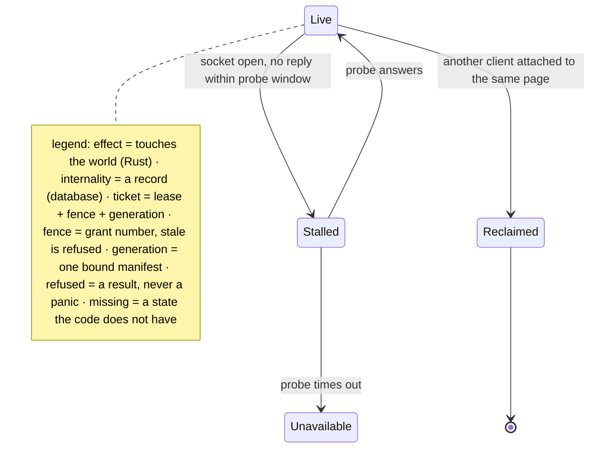

# Browser

The CDP adapter's lifecycle: attach versus launch, and the two things that can be true of a session
that is not alive.

## Page 1 - attach or launch

The distinction that must survive every refactor: `dispose` on a launched session may close the
browser; on an attached session it must not, because somebody else owns it.

---

## Page 2 - the three failures, and the one that hides

`D` is the state the adapter cannot currently name. An open socket is not a live browser, and a
liveness probe is the only thing that distinguishes them - which is why the manifest gives this
crate the `holds-transport` state class and an admission check.

---

## Page 3 - identity, which the review says is conflated

Three things are called "the browser" here: an endpoint, a page, and a user. The review flagged the
collision; the fix is that a `Target` carries its ownership, and that an endpoint is never treated
as an identity.

---

## Page 4 - missing states

`Stalled` and `Reclaimed` do not exist. Both are real: the first is the dead-but-open socket, the
second is two debugger clients on one page - which is exactly what happens when a second tool
attaches to a tab the extension already holds.
