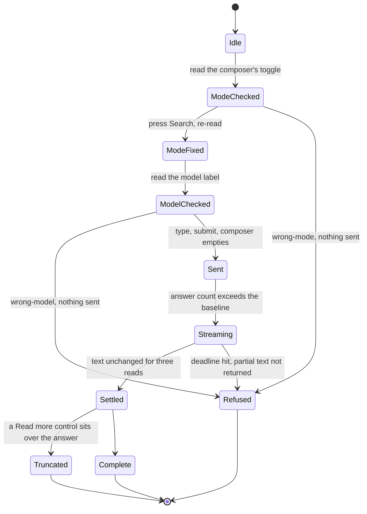
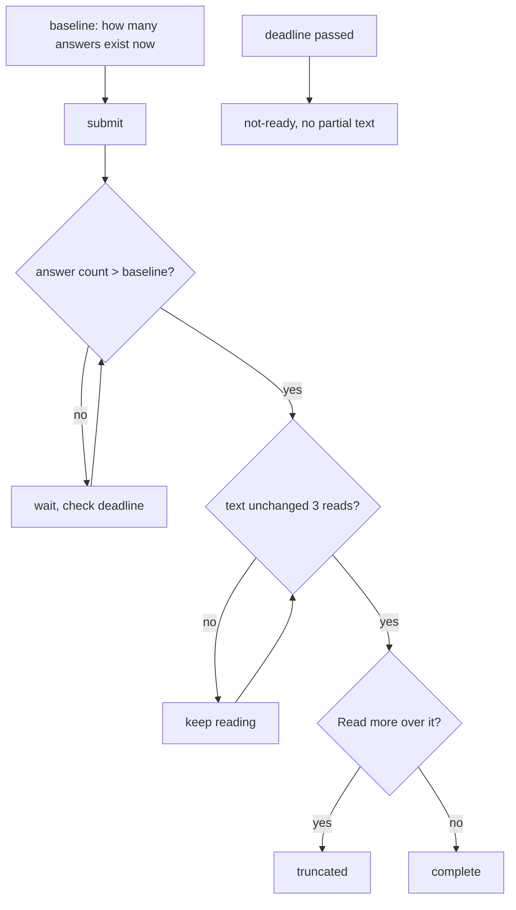
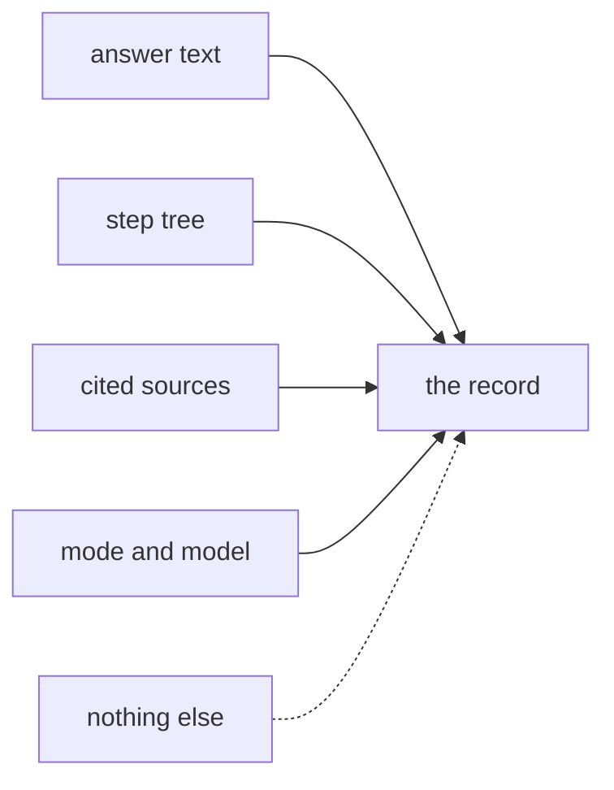
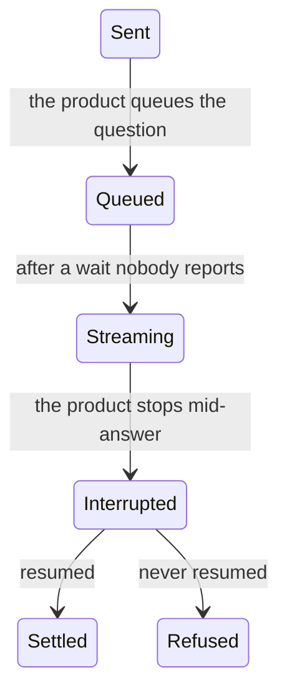

# Chat

Asking a chat product a question, and the three preconditions that must be read before anything is
sent.

## Page 1 - the ask

`Refused` is reached from four different places and means four different things. The manifest gives
it four codes for that reason: `not-ready`, `wrong-mode`, `wrong-model`, `truncated`.

---

## Page 2 - completion, which is a rule and not a sleep

The three-read rule proves text stability, not that generation finished. That is the review's
qualification, and it is why `truncated` is a separate outcome rather than a retry.

---

## Page 3 - the trace, which is not the answer

The trace is how the answer was reached and it is not in the answer text. A capture that keeps only
prose has lost the evidence, which is why the extractor reads the tree separately from the
transcript.

---

## Page 4 - missing states

`Queued` and `Interrupted` are real and unmodelled. The first is why a fixed sleep looks necessary;
the second is why "text stable for three reads" can settle on a truncated answer that nobody marked
as truncated.
