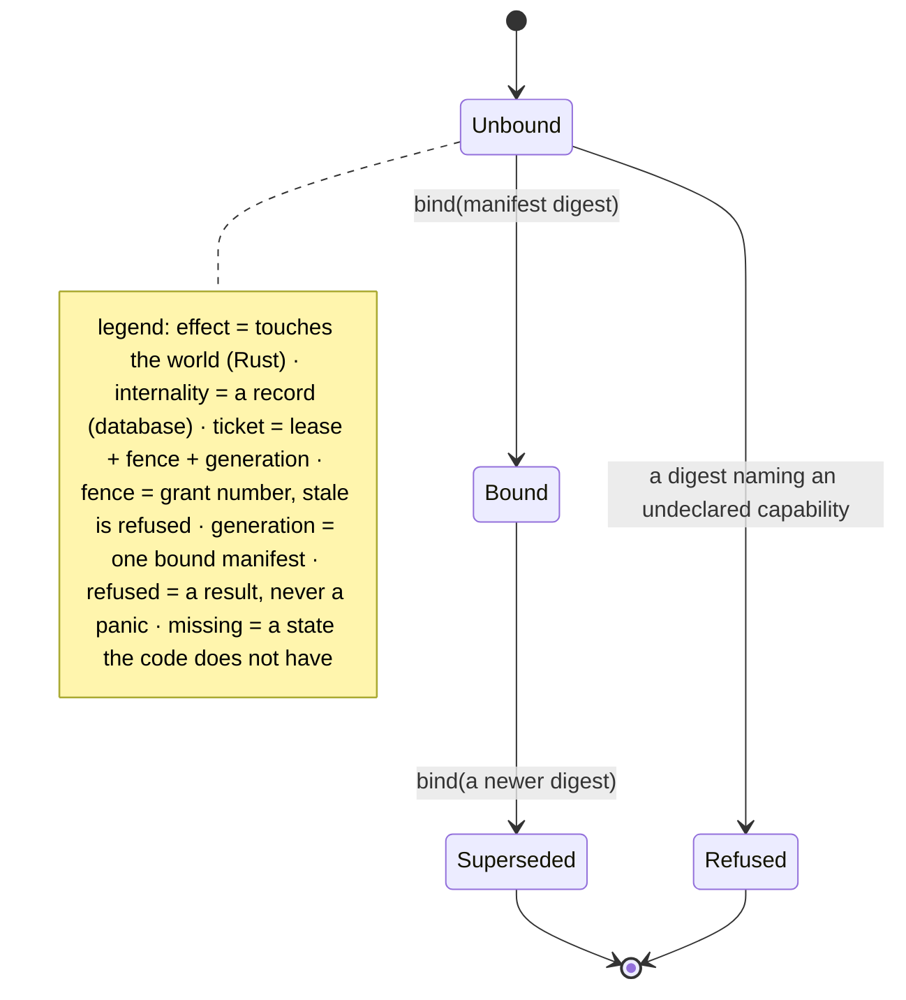
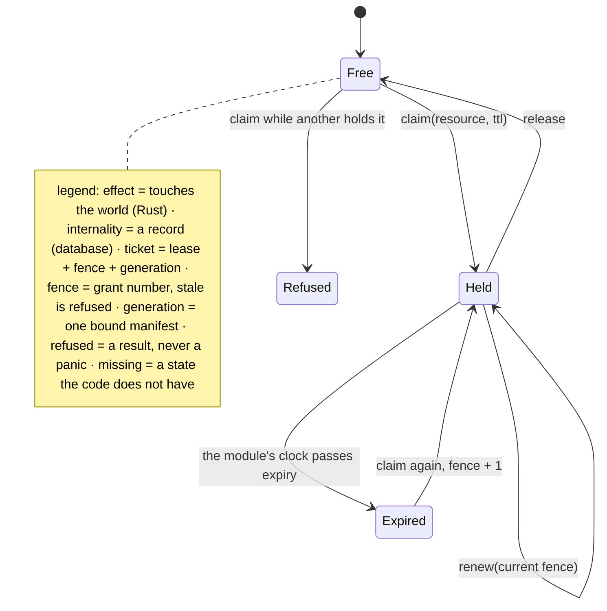
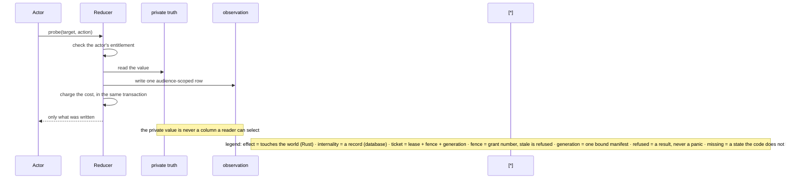
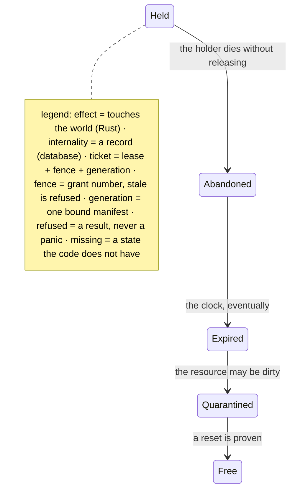

# Database

The rules the database enforces, as states. Everything here is an internality: a reducer moves it,
and a subscriber sees the move.

## Page 1 - a generation

A generation is appended, never updated. The rule that makes it useful: a write under a generation
that is not the latest bound one is refused, and the refusal names the generation it saw.

---

## Page 2 - a lease, and the fence

The fence increments on every grant. A write carrying an old fence is refused - not queued, not
applied late. `Refused` is a result, never a panic.

---

## Page 3 - a probe, and why a receipt is not a disclosure

The review's point stands: a receipt is evidence that a probe happened, not a mechanism that
prevented a leak. The leak is prevented by the private value never being selectable, and by the
observation being tied to a property version so an old grant cannot silently authorise a future
change.

---

## Page 4 - missing states

`Abandoned` and `Quarantined` do not exist. Expiry covers the clock; nothing covers the workspace a
dead holder may have left dirty, which is the `holds-workspace` class the manifest names and the
schema does not yet model.
