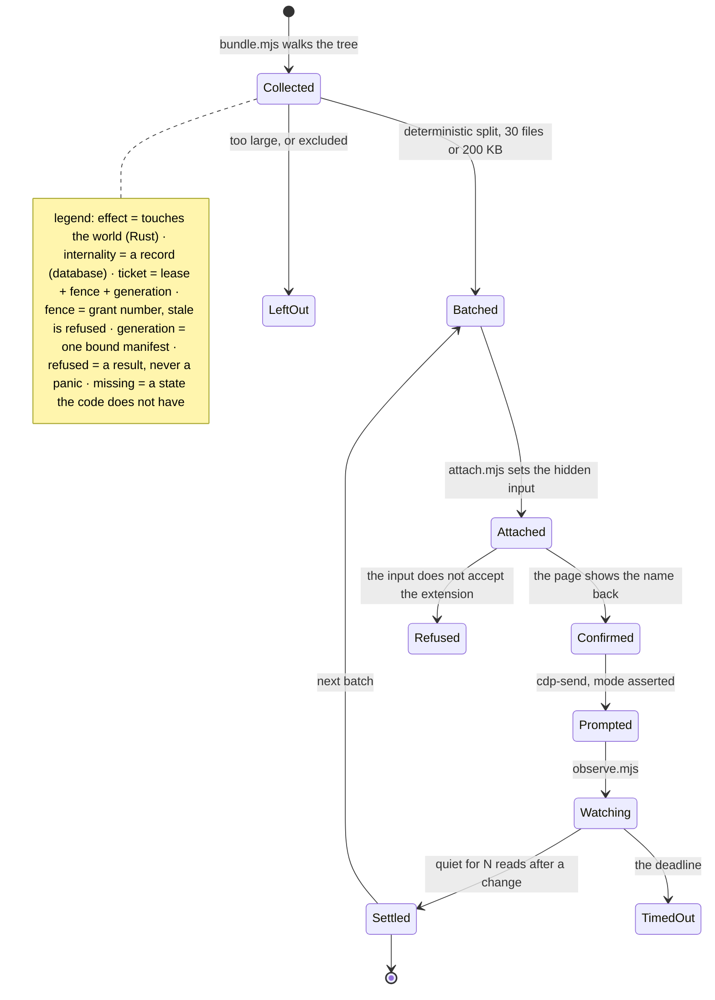
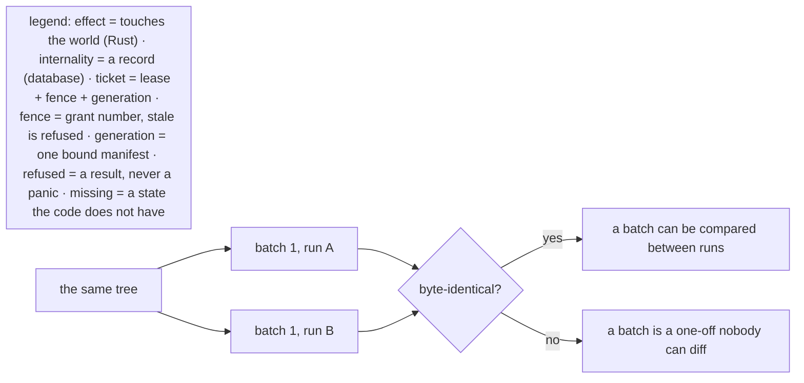
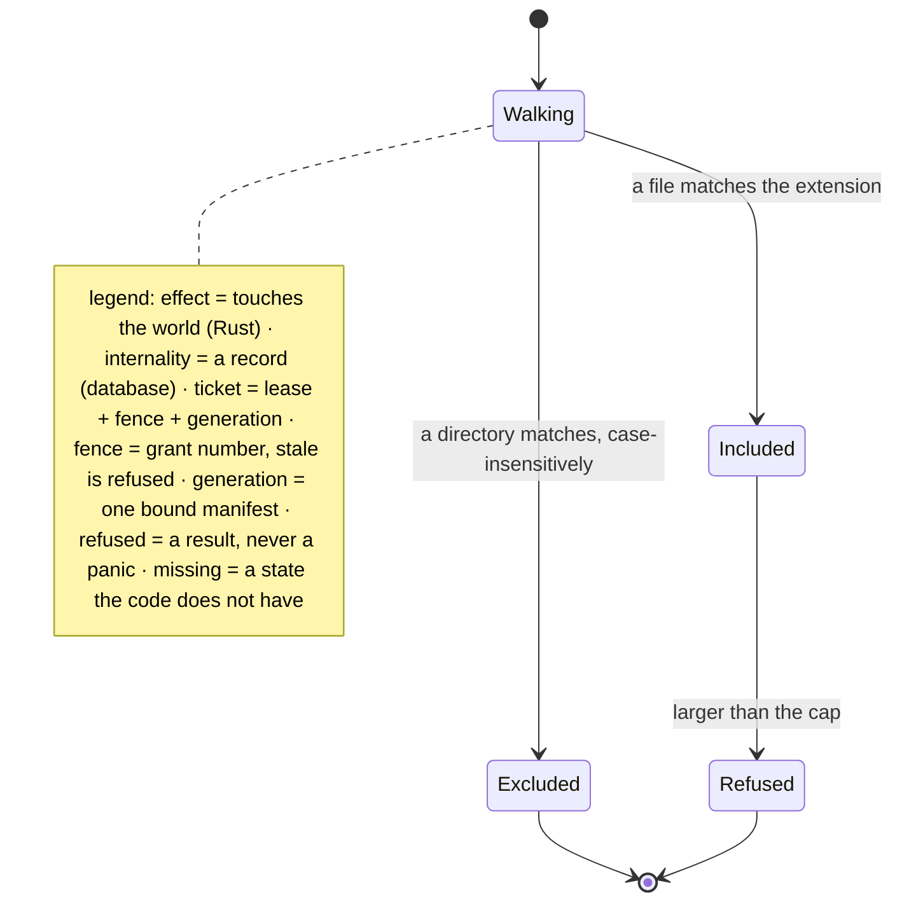
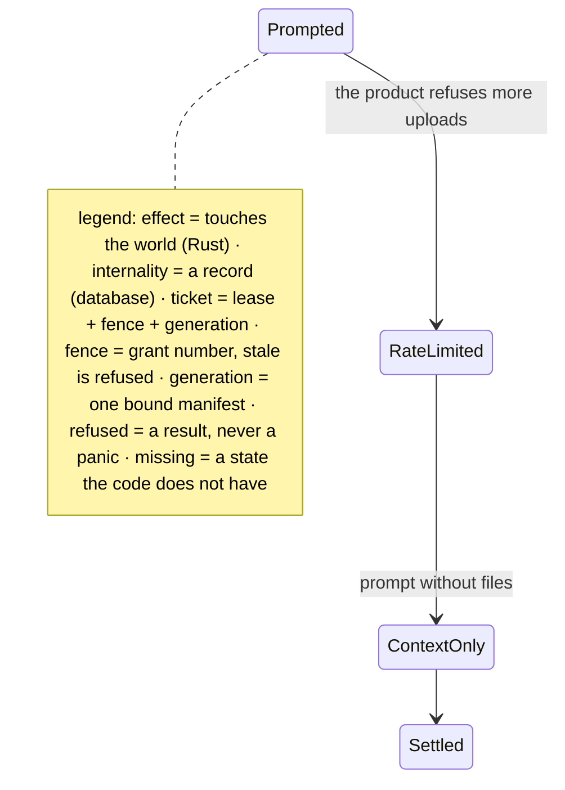

# Feed

The tools that carry a corpus into a chat product: bundle, attach, observe. They are not part of the
agent; they are how the agent reads a distant model.

## Page 1 - the feed

The gate that matters: `Confirmed` is reached only when the page itself shows the file name. A
successful `setFileInputFiles` call is not evidence that the product accepted the file.

---

## Page 2 - why the batches must be deterministic

`Scripts/Feed.mjs` asserts exactly this, because a feed whose batches differ between runs cannot be
reviewed - only re-read.

---

## Page 3 - the exclusion bug, as a state

The first version compared case-sensitively, so `Target/` walked past an exclude of `target` and
three files of build scratch were attached as a batch. On a case-sensitive volume those are
different directories, and the fix belongs in the walker, not in the prompt.

---

## Page 4 - missing states

`RateLimited` is real and unmodelled: a weekly upload quota turns a feed into a text-only
conversation, and the tool has no way to detect it other than by reading the product's own error.
Until it is modelled, the fallback is a person saying so.
